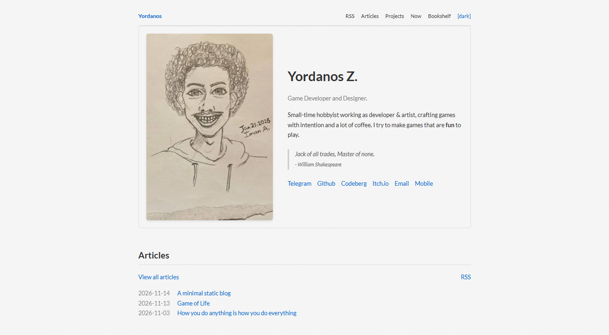
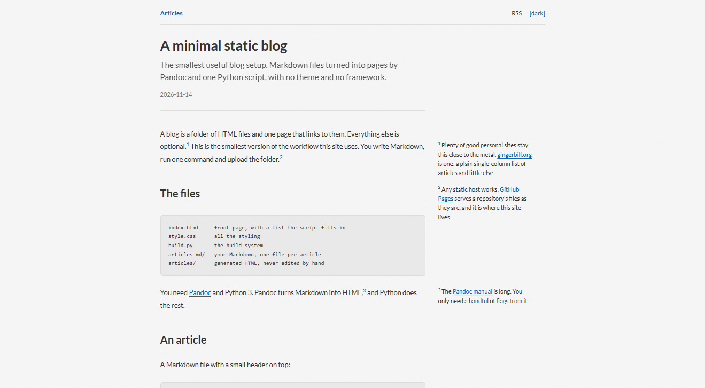

# theyordanos.github.io

My personal site. My simple corner of the internet. Plain HTML and CSS, with articles written in Markdown & built by one Python script, My Projects list and a Bookshelf.


---


## Layout

```text
index.html, archive.html   main page and article lists, filled in by the build
feed.xml                   Atom feed (generated) with browser styling
articles_md/               Markdown source, one file per article
articles/                  generated HTML and template.txt (do not edit the .html)
styles/, scripts/, res/    CSS, JS, images and fonts
build.py                   the build
filters.lua                Pandoc filters
```

## If you want to copy

You'll needs [Pandoc](https://pandoc.org/installing.html) and Python 3.

```text
python build.py           rebuild only what changed
python build.py --force   rebuild everything
```

The build turns each article into HTML, refreshes the lists between the `<!-- ARTICLES:START -->` and `<!-- ARTICLES:END -->` comments in `index.html` and `archive.html`, and rewrites `feed.xml`.
Editing `template.txt`, `filters.lua` or `build.py` rebuilds every article.

### Writing an article

Add `articles_md/some-name.md`. The filename becomes the URL.

```markdown
---
title: Chess in Odin
description: Short summary, used for link previews and the feed.
date: 2026-09-12
draft: true
toc: true
---
```

- `date` is `YYYY-MM-DD`; lists are sorted newest first.
- `draft: true` skips the article. `toc: true` adds a table of contents.
- A title containing a colon must be quoted.
- Footnotes (`^[like this]`) become sidenotes.
