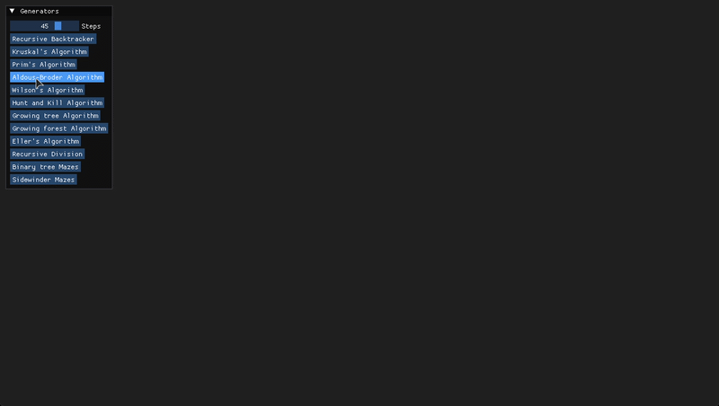

## Aldous-Broder Algorithm

A walker starts in a random room and wanders. Each step it moves to a random neighbouring room. If that room has never been visited, the walker knocks down the wall it just crossed. If it has, it simply walks on. When every room has been visited, the maze is done.

We only ever carve into a room the first time we reach it, so no loops can form.

It is a slow way to make a maze. The walker finds the first rooms quickly, then spends most of its time re-walking old ground, hunting for the last few unvisited ones. In return, it has a rare property: every possible perfect maze is equally likely. ^[Most algorithms have a bias. The Recursive Backtracker, for example, favours long winding corridors. Wilson's Algorithm, later in this series, makes the same unbiased mazes far faster.]



### Pseudocode

```
room = a random room; mark it visited
remaining = total rooms - 1

while remaining > 0:
    next = room + 2 * (a random direction)
    if next is out of bounds: try again
    if next is not visited:
        knock out the wall between room and next
        mark next visited
        remaining -= 1
    room = next
```

### Solution ^[Odin passes an immutable reference to procedure parameters. so we write `room := room` to copy it into a mutable local variable. [Odin Docs](https://odin-lang.org/docs/overview/#calling-conventions)]

```odin
aldous_broder :: proc(maze: ^[COLS][ROWS]Cell, room: [2]i32) {
	room := room // a mutable copy of the parameter
	maze[room.x][room.y] = .PATH

	dirs := [4][2]i32{{-1, 0}, {1, 0}, {0, -1}, {0, 1}}
	remaining := ((COLS - 1) / 2) * ((ROWS - 1) / 2) - 1

	for remaining > 0 {
		dir := rand.choice(dirs[:])
		next := room + 2 * dir

		if !is_cell_in_bounds(next) do continue

		if maze[next.x][next.y] == .WALL {
			wall := room + dir
			maze[wall.x][wall.y] = .PATH
			maze[next.x][next.y] = .PATH
			remaining -= 1
		}

		room = next
	}
}

generate :: proc(maze: ^[COLS][ROWS]Cell) {
	aldous_broder(maze, random_room())
}
```

Run it, press space a few times.
```
odin run .
```
