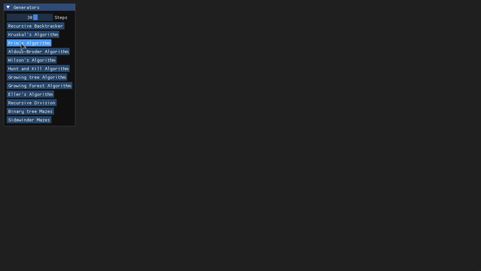
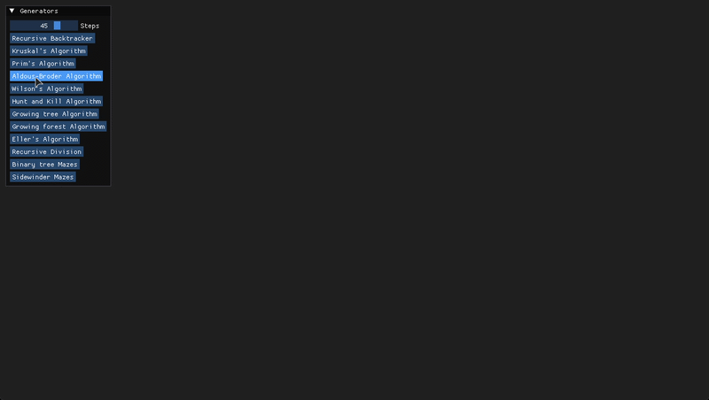
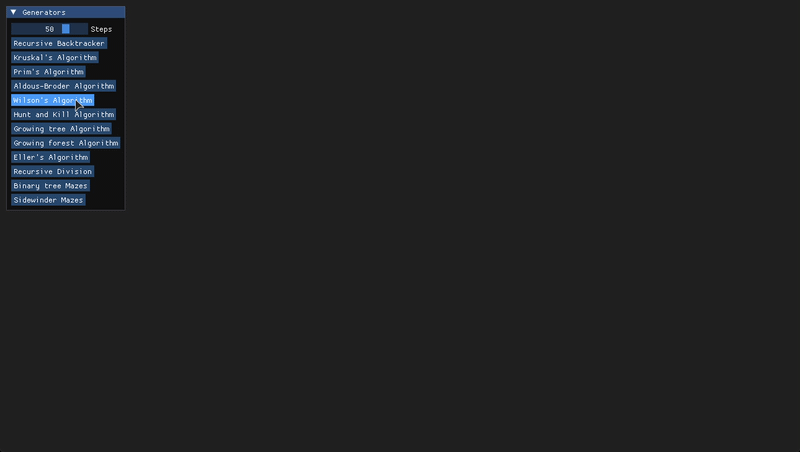
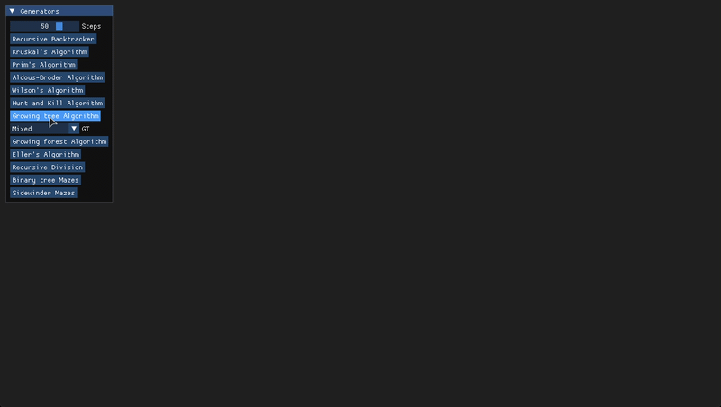

## Recursive Backtracker


```
carve(room):
    mark room as PATH
    for each direction, in random order:
        neighbour = room + 2 * direction
        if neighbour is in bounds and still a WALL:
            knock out the wall between room and neighbour
            carve(neighbour)

start: carve(a random room)
```

## Kruskal's Algorithm


```
for each room: parent[room] = room
walls = every wall between two rooms
shuffle(walls)

for each wall in walls:
    a, b = the two rooms on either side of wall
    if find(a) != find(b):
        knock out the wall
        join(a, b)
```

## Prim's Algorithm



```
carve(start room); add_walls(start room)

while frontier is not empty:
    wall = remove a random wall from frontier
    a, b = the two rooms on either side of wall
    if exactly one of them is not in the maze yet:
        knock out the wall
        open that room
        add_walls(that room)

add_walls(room):
    for each direction:
        wall = room + direction
        far  = room + 2 * direction
        if far is in bounds and not in the maze:
            add wall to frontier
```

## Aldous-Broder Algorithm



```
room = a random room; mark it visited
remaining = total rooms - 1

while remaining > 0:
    next = room + 2 * (a random direction)
    if next is out of bounds: try again
    if next is not visited:
        knock out the wall between room and next
        mark next visited
        remaining -= 1
    room = next
```

## Wilson's Algorithm



```
carve a random room; remaining = total rooms - 1

while remaining > 0:
    start = a random room not in the maze
    room = start
    while room is not in the maze:
        dir = a random direction
        next = room + 2 * dir
        if next is out of bounds: try again
        remember: walk[room] = dir
        room = next

    room = start
    while room is not in the maze:
        carve room and the wall in direction walk[room]
        room = room + 2 * walk[room]
        remaining -= 1
```

## Hunt and Kill Algorithm


```
room = a random room; mark it visited

loop:
    while room has an unvisited neighbour:
        next = a random unvisited neighbour
        knock out the wall between room and next
        mark next visited
        room = next

    found = false
    for each room r in the grid, row by row:
        if r is not visited and has a visited neighbour:
            n = a random visited neighbour of r
            knock out the wall between r and n
            mark r visited
            room = r
            found = true
            stop scanning

    if not found: done
```

## Growing Tree Algorithm



```
active = [a random room]; mark it visited

while active is not empty:
    room = pick one from active
    if room has an unvisited neighbour:
        next = a random unvisited neighbour
        knock out the wall between room and next
        mark next visited
        add next to active
    else:
        remove room from active
```

## Growing Forest Algorithm


```
every room is its own set; all rooms uncarved
start N trees: carve a random room, add to active

while active is not empty:
    maybe start a new tree (with some chance)
    room = pick one from active
    if room has no uncarved neighbour:
        remove room from active
        continue
    next = room + 2 * (a random direction in bounds)
    if next is uncarved:
        knock out the wall, carve next, join sets, add next to active
    else if find(room) != find(next):
        knock out the wall, join sets

merge what's left: Kruskal's pass over every wall
```

## Eller's Algorithm


```
row 0: every room gets a new set id

for each row of rooms:
    for each pair of neighbouring rooms in this row:
        if their sets differ and (this is the last row or a coin flip says so):
            knock out the wall between them; merge the two sets

    if this is the last row: done

    for each set in this row:
        pick at least one room in it; knock out the wall below each pick
        those rooms in the next row carry the set id

    every other room in the next row gets a new set id
```

## Recursive Division Algorithm


```
divide(chamber):
    if the chamber is a single room: return
    choose a direction: split across the longer side (random if it's square)
    wall = a random position strictly inside the chamber, running the full length
    gap = a random position along that wall
    build the wall everywhere except the gap
    divide(first half)
    divide(second half)

start: open everything inside the border; divide(the whole grid)
```

## Binary Tree Algorithm


```
for each room:
    options = the directions south and east where the room beyond is in bounds
    if options is not empty:
        knock out the wall in a random one of them
```

## Sidewinder Algorithm


```
for each row of rooms:
    run = []
    for each room in the row, left to right:
        add room to run
        at_end = room is in the last column
        if this is the last row:
            knock out the wall to the east, unless at_end
        else if at_end or a coin flip (close_chance) says so:
            pick a random room in run; knock out the wall below it
            run = []
        else:
            knock out the wall to the east
```
