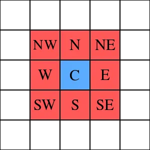
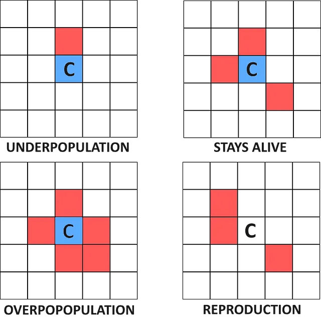
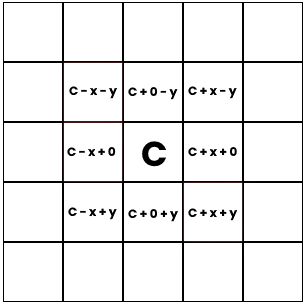
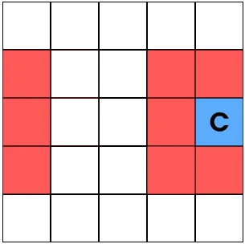
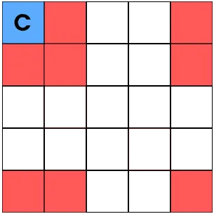
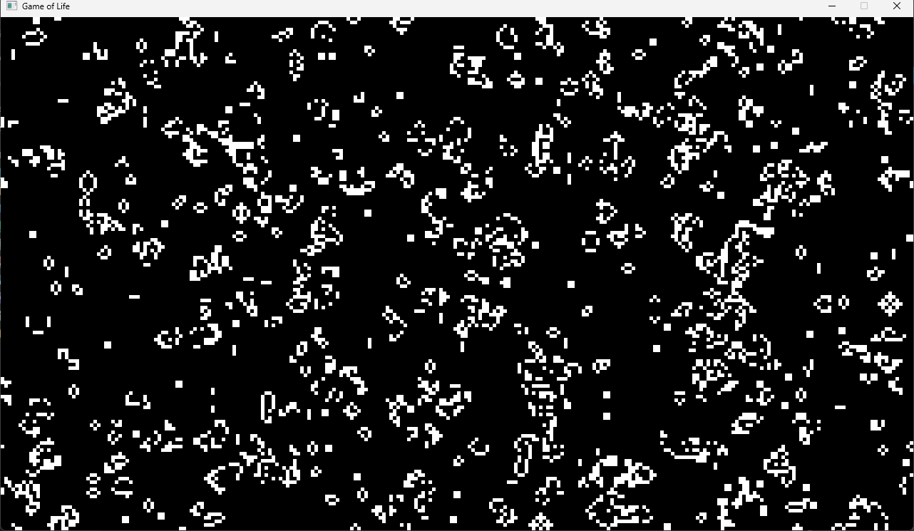

The [Game of Life](https://en.wikipedia.org/wiki/Conway%27s_Game_of_Life) is a cellular automata made by a British mathematician name [John Horton Conway](https://en.wikipedia.org/wiki/John_Horton_Conway) in 1970.

Conway’s Game of Life is a zero-player game, meaning that if you don’t have any friends to play with and are playing solo, it will ignore you more than your imaginary friends would.

According to Wikipedia:

> A cellular automaton consists of a regular grid of _cells_, each in one of a finite number of states, such as _on_ and _off_. The grid can be in any finite number of dimensions. For each cell, a set of cells called its _neighborhood_ is defined relative to the specified cell.

In simpler terms, a cellular automata is a bunch of cells in a grid acting according to some specified rules.

Conway’s Game of Life is a good example of how complex behaviors can emerge from simple inputs and rules. I'll show you how to implement this algorithm using [Odin](https://odin-lang.org) and [Raylib](https://raylib.com).

A cell in GOL is one square in the grid. A cell can have two states, on or off, alive or dead, call it whatever you like. GOL considers a cell’s neighbors to be the Moore neighborhood which are the 8 surrounding cells instead of the 4 (N, E, W and S).



The Game of Life follows these simple rules for each cell:

1. A live cell with fewer than two live neighbors dies (**underpopulation**).
2. A live cell with two or three live neighbors **stays alive**.
3. A live cell with more than three live neighbors dies (**overpopulation**).
4. A dead cell with exactly three live neighbors becomes alive (**reproduction**).



Let’s start by declaring imports, constants, and cell state.

```odin
package main

import "core:math/rand"
import rl "vendor:raylib"

SCREEN_WIDTH :: 1280
SCREEN_HEIGHT :: 720
CELL_SIZE :: 5
ROWS :: SCREEN_HEIGHT / CELL_SIZE
COLS :: SCREEN_WIDTH / CELL_SIZE

State :: enum byte { DEAD, ALIVE }

grid: [COLS][ROWS]State // Active Grid
next: [COLS][ROWS]State // Next Generation
```

Why is there a another 'next' array? The Game of Life algorithm does not update each individual cell alone. Its a generational algorithm, meaning it calculates every cells next state and then update the grid all at once instead of calculate and update each cell separately.

Initialize raylib in the main function:
```odin
main :: proc() {
	// Initialize grid here...

	rl.SetTraceLogLevel(.ERROR)
	rl.InitWindow(SCREEN_WIDTH, SCREEN_HEIGHT, "Game of Life")
	defer rl.CloseWindow()

	rl.SetTargetFPS(60)

	for rl.WindowShouldClose() == false {
	
		// Update the grid here...

		rl.BeginDrawing()
		rl.ClearBackground(rl.RAYWHITE)

		// Draw the grid here...
		
		rl.EndDrawing()
	}
}
```

## Initialize
Many Game of life implementations use mouse input to toggle between cell's state, but for our implementation we'll initialize all grid cells with a random 50/50 chance state.
```odin
for x in 0..<COLS {
	for y in 0..<ROWS {
		grid[x][y] = rand.float32() > 0.5 ? .ALIVE : .DEAD
	}
}
```

## Draw
We draw ALIVE cells as white and DEAD cells as black.
```odin
for x in 0..<COLS {
	dx := i32(x * CELL_SIZE)

	for y in 0..<ROWS {
		dy := i32(y * CELL_SIZE)

		color: rl.Color = grid[x][y] == .ALIVE ? rl.WHITE : rl.BLACK

		rl.DrawRectangle(dx, dy, CELL_SIZE, CELL_SIZE, color)
	}
}
```
## Update
```odin
for x in 0..<COLS {
	for y in 0..<ROWS {

		neighbours_count: i32 = 0
		for i in -1..=1 {
			for j in -1..=1 {
				if i == 0 && j == 0 do continue

				dx := (x + i + COLS) % COLS
				dy := (y + j + ROWS) % ROWS

				if grid[dx][dy] == .ALIVE do neighbours_count += 1
			}
		}

		if grid[x][y] == .ALIVE {
			next[x][y] = (neighbours_count == 2 || neighbours_count == 3) ? .ALIVE : .DEAD
		} else {
			next[x][y] = neighbours_count == 3 ? .ALIVE : .DEAD
		}

	}
}

grid = next
```

Here is what's happening:

1. We iterate through every single cell
2. We calculate how many neighbors the cell has.
3. Based on the rules of Game of Life we laid out earlier we set its state.
	- A cell stays alive if and only if it has exactly 2 or 3 neighbors. Otherwise it dies.
	- A cell becomes alive if it has exactly 3 neighbors.
4. We update the grid all at once by setting `grid = next`

This is how the next for loops work to find Moore’s neighborhood.
```odin
for i in -1..=1 {
	for j in -1..=1 {
		// ...
	}
}
```


Notice which cells we consider to be neighbors:
```odin
dx := (x + i + COLS) % COLS
dy := (y + j + ROWS) % ROWS
```
This is what we call a [Torus](https://en.wikipedia.org/wiki/Torus) world. It simply means that the world wraps around. To make it clear, this is what it looks:



Normally to get the neighbors of the cell you write it like this
```odin
dx := x + i
dy := y + j
```

But this will give us an out of bounds error. If the max columns is 10 and i = 9, then 9 + 1 = 10 which is out of bound since odin uses 0 based indexing.

So we use the modulus operator, which return the reminder
```odin
dx := (x + i) % COLS
dy := (y + j) % ROWS
```

So why do we need to add COLS or ROWS before we divide it using modulus? What if
```odin
// x = 0 and i = -1, can happen to first column cells
// that would result in...

dx := (x + i) % COLS  
dx := (0 - 1) % COLS  
dx := -1 % COLS // This wouldn't return the right most column

// Soo we have to add COLS and ROWS to resolve this problem  
int dx = (i + x + COLS) % COLS;
int dy = (j + y + ROWS) % ROWS;
```

## Run
Now rut it and look
```
odin run .
```



Try adding additional features like pausing, steping with a key press, clicking to toggle cell state, restart/clearing the grid and and explore how initial conditions affect the patterns that emerge.

Pausing can be achieved by holding a variable `is_running: bool` and updating it with a key press
```odin
if rl.IsKeyPressed(.SPACE) do is_running = !is_running

if is_running {
	// Update...
}
```

Mouse interactions:
```odin
if rl.IsMouseButtonPressed(.LEFT) {
	mouse_pos := rl.GetMousePosition()

	x := i32(mouse_pos.x / f32(CELL_SIZE))
	y := i32(mouse_pos.y / f32(CELL_SIZE))

	grid[x][y] = grid[x][y] == .ALIVE ? .DEAD : .ALIVE
}
```

You can find additional information on [Game of Life's Wiki](https://en.wikipedia.org/wiki/Conway%27s_Game_of_Life). Enjoy :)

## Full source code
```odin
package main

import "core:math/rand"
import rl "vendor:raylib"

SCREEN_WIDTH :: 1280
SCREEN_HEIGHT :: 720
CELL_SIZE :: 5
ROWS :: SCREEN_HEIGHT / CELL_SIZE
COLS :: SCREEN_WIDTH / CELL_SIZE

State :: enum byte { DEAD, ALIVE }

grid: [COLS][ROWS]State
next: [COLS][ROWS]State

main :: proc() {
	for x in 0..<COLS {
		for y in 0..<ROWS {
			grid[x][y] = rand.float32() > 0.5 ? .ALIVE : .DEAD
		}
	}

	rl.SetTraceLogLevel(.ERROR)
	rl.InitWindow(SCREEN_WIDTH, SCREEN_HEIGHT, "Game of Life")
	defer rl.CloseWindow()

	rl.SetTargetFPS(60)

	for rl.WindowShouldClose() == false {
		for x in 0..<COLS {
			for y in 0..<ROWS {

				neighbours_count: i32 = 0
				for i in -1..=1 {
					for j in -1..=1 {
						if i == 0 && j == 0 do continue

						dx := (x + i + COLS) % COLS
						dy := (y + j + ROWS) % ROWS

						if grid[dx][dy] == .ALIVE do neighbours_count += 1
					}
				}

				if grid[x][y] == .ALIVE {
					next[x][y] = (neighbours_count == 2 || neighbours_count == 3) ? .ALIVE : .DEAD
				} else {
					next[x][y] = neighbours_count == 3 ? .ALIVE : .DEAD
				}

			}
		}

		grid = next

		rl.BeginDrawing()
		rl.ClearBackground(rl.WHITE)

		for x in 0..<COLS {
			dx := i32(x * CELL_SIZE)

			for y in 0..<ROWS {
				dy := i32(y * CELL_SIZE)

				color: rl.Color = grid[x][y] == .ALIVE ? rl.WHITE : rl.BLACK

				rl.DrawRectangle(dx, dy, CELL_SIZE, CELL_SIZE, color)
			}
		}

		rl.EndDrawing()
	}
}
```

## In honor of John Horton Conway

