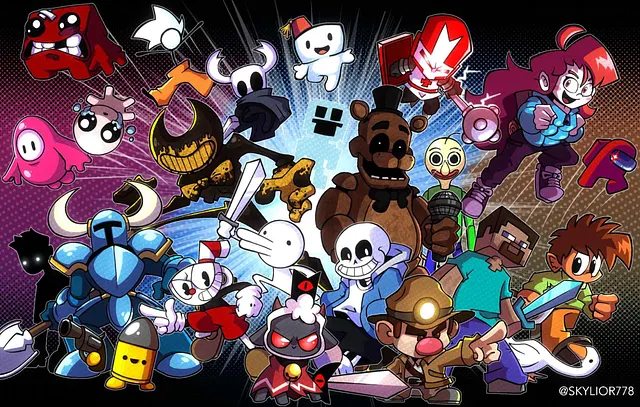

The antagonist from John Wick said this quote. And I find this to be a very interesting take.

How do you do anything? Just pick out a simple topic. A hobby, work, school, or any activity that comes your way.

I personally love playing games and making them. I believe they are the peak of any art form (blog on that soon :p).

This quote got me into thinking how I play games. What kind of games I play? How do I play the kind of game that I picked up to play? And do I play the game that I picked up to play in a way it is meant to be played or at least the way I intend to play it?

- Are you stealthy & meticulous? or Do you go guns blazing?
- Do you like to think before you solve a problem or do you solve problems by trial and error?
- Quick or Calm?
- Simple or Complex?
- Easy or Difficult?
- Mechanical or Artistic?
- Freestyle or Rules?
- Chance or Skill?
- Slow or Fast?
- Do you finish what you started or no?
- Maybe you’re a victim of Shiny object syndrome like yours truly :)
- How is your attention when doing something?
- Also how is your focus?
- All of us have patterns. We are pattern based creatures. Patterns that we are familiar with that guide us throughout any activity. Those patterns translate into many many more encounters in life.

I was doing two comparisons in the list and I know that life isn’t black and white.

So, you ask your own questions. How do you do a just one thing? because…

**How you do anything is how you do everything.**
