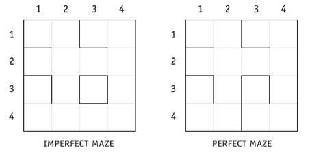

A *maze* is a complex network of paths, walls, and branches. There are different kind of mazes. Mazes that features dead ends, closed areas, loops and ones that are 'perfect'. By 'perfect' maze, we don't mean mazes that are superior to other types of mazes. Its just indicates a specific structural type that contains no loops and no inaccessible areas, and exactly one unique path between any two points inside the maze.



A perfect maze is equivalent to a **tree** in graph theory^[math field that studies about graphs, which are pairwise relationships between objects. You can read more on that on [graph theory wikipedia](https://en.wikipedia.org/wiki/Graph_theory)], meaning it is a minimal spanning tree ^[The cheapest way to connect a set of points (like cities, houses, computers, or maze rooms in this case) together so that every point is reachable, with no loops or cycles] over the set of rooms. This is the stuctural guarantee for only one single solution unlike other (imperfect) maze types.

### Maze generation algorithms we'll be making in this series:

1. Recursive Backtracker
2. Kruskal's Algorithm
3. Prim's Algorithm
4. Aldous-Broder Algorithm
5. Wilson's Algorithm
6. Hunt and Kill Algorithm
7. Growing tree Algorithm
8. Growing forest Algorithm
9. Eller's Algorithm
10. Recursive Division
11. Binary tree Mazes
12. Sidewinder Mazes

### Resources

These are information sources that were used in the making of this series and ones that you can look into to have deeper understanding.

- [Think Labyrinth: Maze algorithms](https://astrolog.org/labyrnth/algrithm.htm)
- [Wikipedia: Maze Generation Algorithm](https://en.wikipedia.org/wiki/Maze_generation_algorithm)
- Amazing visualization on [Professor-L page](https://professor-l.github.io/mazes/)

### Tools

We'll be using [Odin](https://odin-lang.org) and [SDL3](https://libsdl.org).

## Boilerplate and Initial Code

Before any algorithm, we need a grid to carve into and a way to look at the result. Everything here is shared by every article in the series, so we'll write it once.

### The grid

The maze lives on a 2D grid. A single position in that grid is a *cell*, and every cell is either a wall or a path. A maze starts as a solid block of walls, and a generator carves paths out of it.

```odin
Cell :: enum byte { WALL, PATH }
```

`WALL` comes first on purpose. Odin zero-initializes everything, so a freshly declared grid is already full of walls.

The grid size needs to be **odd** ^[I saw this way of making a grid, where rooms and walls are all cells of one grid instead of separate cell + wall data, from [professor-l's page](https://professor-l.github.io/mazes/)]:

```odin
CELL_SIZE :: 20
COLS :: 65
ROWS :: 37
```

#### Cell Types
**Rooms** sit where both x and y are odd, they're always paths. **Walls** sit where exactly one coordinate is odd, it can be either wall or path. **Pillars** sit where both coordinates are even, they are always walls. **Outside cells** are the border, they are always walls.

### Helpers

```odin
random_room :: proc() -> [2]i32 {
	return {
		rand.int31_max(COLS / 2) * 2 + 1,
		rand.int31_max(ROWS / 2) * 2 + 1,
	}
}

// The border (index 0 and the last index) is always outside, so a
// valid room is strictly inside it.
is_cell_in_bounds :: proc(c: [2]i32) -> bool {
	return c.x > 0 && c.x < COLS - 1 && c.y > 0 && c.y < ROWS - 1
}
```

Note the bounds check is `> 0` and `< COLS - 1`. Index 0 and index `COLS - 1` are the outside cells, so they are off limits.

### The generator hook

Each article will implement one procedure with this shape:

```odin
generate :: proc(maze: ^[COLS][ROWS]Cell) {
	// the algorithm goes here
}
```

It takes a pointer to the grid and carves into it. A fixed-size array is a value in Odin, so passing it without `^` ^[`^` is called a Caret. It is Odin's symbol for pointers. Similar to how `*` (asterisk ) is in most systems languages. [Pointers in Odin](https://odin-lang.org/docs/overview/#pointers)] would hand the procedure a copy and your changes would vanish.

### Window and drawing

Finally, SDL3 gives us a window and a renderer, and we draw one filled square per cell:

```odin
package main

import "core:fmt"
import "core:math/rand"
import sdl "vendor:sdl3"

Cell :: enum byte { WALL, PATH }

CELL_SIZE :: 20
COLS :: 65
ROWS :: 37

CLR_WALL :: [4]u8{32, 32, 32, 255}
CLR_PATH :: [4]u8{245, 245, 245, 255}

random_room :: proc() -> [2]i32 {
	return {
		rand.int31_max(COLS / 2) * 2 + 1,
		rand.int31_max(ROWS / 2) * 2 + 1,
	}
}

is_cell_in_bounds :: proc(c: [2]i32) -> bool {
	return c.x > 0 && c.x < COLS - 1 && c.y > 0 && c.y < ROWS - 1
}

generate :: proc(maze: ^[COLS][ROWS]Cell) {
	// the algorithm goes here
}

draw_maze :: proc(renderer: ^sdl.Renderer, maze: ^[COLS][ROWS]Cell) {
	for x in 0 ..< COLS {
		for y in 0 ..< ROWS {
			clr := maze[x][y] == .WALL ? CLR_WALL : CLR_PATH
			rect := sdl.FRect{
				x = f32(x * CELL_SIZE),
				y = f32(y * CELL_SIZE),
				w = CELL_SIZE,
				h = CELL_SIZE,
			}

			sdl.SetRenderDrawColor(renderer, clr.r, clr.g, clr.b, clr.a)
			sdl.RenderFillRect(renderer, &rect)
		}
	}
}

main :: proc() {
	if !sdl.Init({.VIDEO}) {
		fmt.eprintln("sdl.Init:", sdl.GetError())
		return
	}
	defer sdl.Quit()

	window := sdl.CreateWindow("Maze", COLS * CELL_SIZE, ROWS * CELL_SIZE, {})
	if window == nil {
		fmt.eprintln("sdl.CreateWindow:", sdl.GetError())
		return
	}
	defer sdl.DestroyWindow(window)

	renderer := sdl.CreateRenderer(window, nil)
	if renderer == nil {
		fmt.eprintln("sdl.CreateRenderer:", sdl.GetError())
		return
	}
	defer sdl.DestroyRenderer(renderer)

	sdl.SetRenderVSync(renderer, 1)

	maze: [COLS][ROWS]Cell
	generate(&maze)

	running := true
	for running {
		event: sdl.Event
		for sdl.PollEvent(&event) {
			#partial switch event.type {
			case .QUIT:
				running = false
			case .KEY_DOWN:
				// Space: throw the maze away and generate a new one
				if event.key.scancode == .SPACE {
					maze = {}
					generate(&maze)
				}
			}
		}

		sdl.SetRenderDrawColor(renderer, 0, 0, 0, 255)
		sdl.RenderClear(renderer)
		draw_maze(renderer, &maze)
		sdl.RenderPresent(renderer)
	}
}
```

Run it now and you should see a window of solid walls. Press space and nothing changes, because `generate` is empty. The different algorithms we'll be looking into in this series are going to be just filling the `generate` procedure.
