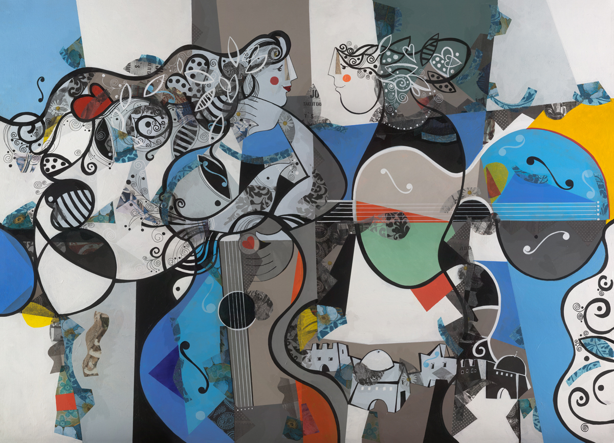

*Minimalism*. What does that even mean? Lets see what good old Wikipedia has to say about this.

> **[Minimalism](https://en.wikipedia.org/wiki/Minimalism "Minimalism")** is a movement in visual arts, music, and other media that began in post–World War II Western art.

Okay obviously we're not just talking about art minimalism. Minimalism can be associated with a lot of fields.^[Here is a list of different minimalisms. [Minimalism (disambiguation)](https://en.wikipedia.org/wiki/Minimalism_(disambiguation)) ]

**Art Minimalism** is an art movement^[Style followed by a group of artist for a specific period of time.] that is about reducing art to its essentials, focusing on the object itself and the viewer's experience, with as little mediation from the artist as possible.



*Minimal* means as small, slight, or low as possible, or characterized by extreme simplicity and the use of *only essential* features.

**Only Essential**; That is the biggest definition of minimalism in my opinion. Since wiki insists we talk about Art. Lets look into that first.

> Minimalism is not a lack of something. It’s simply the perfect amount of something.
> 
> — Nicholas Burroughs^[[James Clear - Minimalism](https://jamesclear.com/minimalism)]

I got the idea of a minimalist article and Simple vs Complex & Easy vs Difficult from Bill Hall's ^[Also know as GingerBill, Creator of The Odin Programming Language] [Good Tools are Invisible](https://www.gingerbill.org/article/2026/07/10/good-tools-are-invisible/) article.

Lets look at something a lot of people mix up. The idea of simple = easy and complex = difficult.

Simple
: Not complicated in structure; having few parts, layers, or steps; easy to understand or do because it is straightforward.

Complex
: Involving many interconnected parts, variables, or relationships that work together and often lead to unpredictable outcomes.

*Simple* and *Complex* refer to structural design or number of parts.

Easy
: Requiring very little effort, labor, or specialized skill to accomplish.

Difficult
: Needing a lot of effort, skill, endurance, or problem-solving capability to deal with or complete.

*Easy* and *Difficult* describe the amount of effort or skill needed by a person

I love simple, but that doesn't mean I just love something that is easy and doesn't take any effort to learn or do. Something simple can be very difficult to use and something complex can be easy to learn.

Since I'm a Game Developer, I'll compare these things with programming languages. Two languages that I think are good examples of this are Python and C.

C is a systems programming language, that just means it is closer to the metal. Python is a dynamic and interpreted language usually closer to human language.

```c
#include <stdio.h>

int main() {
    printf("Hello, World!\n");
    return 0;
}
```

```python
print("Hello, World!")
```

This is the most basic programming in any language. Look at how these two handle it, C is the top one and Python the bottom. At first glance python looks like the simple language and C the complex, but don't get fooled, more code in a programming language usually means that language has few abstractions.

Abstractions are layers between the computer and the one using that computer. Usually, the less you write the more the abstraction.

By the definition of *simple*, C is simpler than Python but Python is *easier* than C.

Languages and tools have both characters. Some are simple and difficult, some are complex and easy, some are simple and easy ^[Lua is one I consider to be simple and easy], some are complex and difficult. ^[C++, Rust, many of the OOP languages fit into this catagory]

I love minimalism. Minimal means only essential. In most cases, Minimal means Simple. That doesn't guarantee Easy but it does guarantee non-abstract.

If you got bored by my programming language comparisons, here are some good articles that I think are way better written than my scribbles.

- [James Clear - Minimalism](https://jamesclear.com/minimalism)
- [Mark Mason - Minimalism](https://markmanson.net/minimalism)
- [Becoming Minimalist Website](https://www.becomingminimalist.com/)
- [Wiki, of course](https://en.wikipedia.org/wiki/Minimalism)
